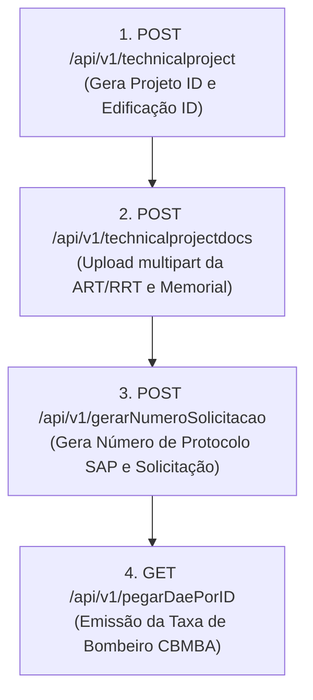
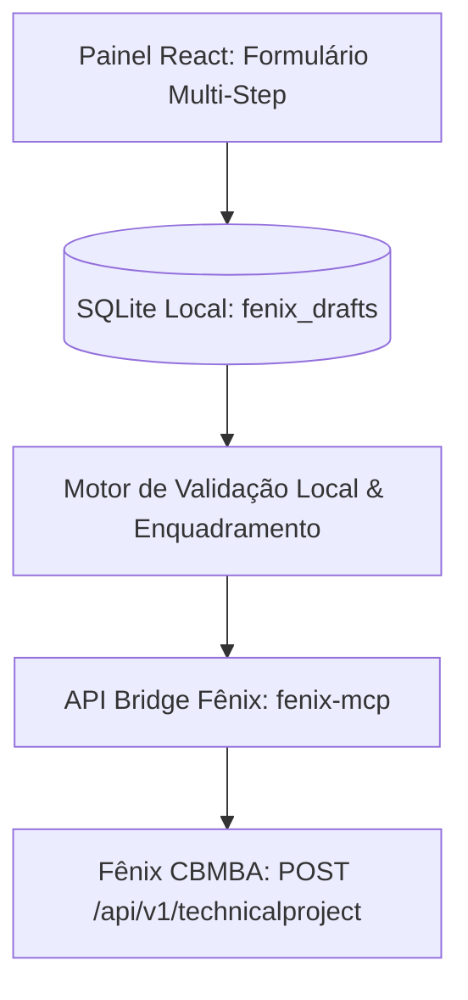

# Superdocumentação Definitiva do Fluxo de Cadastro: Edificação e Projeto Técnico (Fênix CBMBA)

> **Documento de Engenharia Reversa e Integração**  
> **Sistema**: Fênix CBMBA (Corpo de Bombeiros Militar da Bahia)  
> **Versão do Bundle Frontend**: `2.19.1` (`app.204b8f23.js`)  
> **Base de Testes e Validação Real**: ABA Plataforma de Negócios LTDA (`ABA Incêndio`, solicitante #9634, user #14574)

---

## 1. Descoberta Arquitetural Crítica

### A Ilusão do Cadastro Isolado de Edificação
Na documentação de rotas e na declaração de serviços do Fênix, constam os seguintes endpoints RESTful clássicos:
- `POST /api/v1/edifications` (declarado no serviço `Cn.enviarDados`)
- `PUT /api/v1/edifications/{id}` (declarado no serviço `Cn.update`)

No entanto, a engenharia reversa do código-fonte do bundle Vue (`app.204b8f23.js`) comprovou um fato fundamental:
**O frontend da aplicação web do Fênix NUNCA invoca `POST /api/v1/edifications` nem `PUT /api/v1/edifications/{id}`.**

### Como o Fênix Realmente Opera
No Fênix CBMBA, a **Edificação não possui ciclo de vida desacoplado de um Projeto Técnico ou Solicitação**:
1. **Não existe rascunho de edificação no servidor**: Uma edificação não pode ser criada "órfã" na interface.
2. **A Etapa 1 (`/#/app/edification/new`, componente `edification-form`) é meramente local**: Ao preencher endereço e dados estruturais e clicar no botão **`CONTINUAR`**, o frontend Vue **não faz requisição de mutação (POST/PUT) na rede**.
3. **Passagem de Estado via Vue Router**: O componente valida todos os campos reativos no cliente e invoca:
   ```javascript
   this.$router.replace({
     name: "technicalProjects-form",
     params: {
       id: "new",
       edification: this.edification,
       address: this.address,
       // flags de enquadramento
     }
   });
   ```
4. **Persistência Atômica na Etapa 2 (`POST /api/v1/technicalproject`)**:
   O salvamento no banco de dados acontece exclusivamente no método `save()` do componente `technicalProjects-form` (`/#/app/technicalproject/new`).
   Nesse momento, os campos da edificação e do endereço são **mesclados na raiz do payload** (`dataResource`), informando:
   - `"edificacao_id": "new"` (quando o imóvel está sendo cadastrado pela primeira vez)
   - `"edificacao_id": 94965` (quando foi reaproveitada uma edificação existente da conta)

---

## 2. Etapa 1 — Formulário de Edificação e Endereço (`edification-form`)

A Etapa 1 é responsável por coletar a localização física e as características geométricas e estruturais do imóvel.

### 2.1 Rotas de Leitura e Apoio

| Rota | Método | Função |
|---|---|---|
| `/api/v1/detailsRequester` | `GET` | Obtém os dados do usuário autenticado (`user.id`, perfil, papel). |
| `/api/v1/usuarios/{id}/edifications` | `GET` | Lista as edificações já vinculadas ao solicitante (para autopreenchimento). |
| `/api/v1/address` | `POST` | Busca endereço de uma edificação existente (`multipart/form-data` ou `urlencoded` com `edificacao_id`). |
| `/api/v1/counties` / `/api/v1/getAllCountys` | `GET` | Catálogo de municípios do estado da Bahia. |

> **Nota**: A rota `GET /api/v1/edifications` retorna HTTP 404 no Fênix 2.19.1. A consulta oficial da lista de imóveis da conta é sempre `GET /api/v1/usuarios/{id}/edifications`.

### 2.2 Estrutura do Objeto `address` (Endereço)

```json
{
  "zip_code": "45355000",
  "public_place": "RUA OTACILIO PINHEIRO",
  "number": "S/N",
  "complement": "***",
  "district": "CENTRO",
  "county": "APUAREMA",
  "municipio_id": 22,
  "state": "BA",
  "geographic_coordinates": null
}
```

#### Regras de Campo e Validação:
- `zip_code` (string, 8 dígitos numéricos sem hífen). O preenchimento do CEP dispara no Vue a busca automática do logradouro e do município via `GET /api/v1/counties`.
- `public_place` (string, máx. 100 caracteres): Obrigatório. Nome da rua, avenida, praça, rodovia.
- `number` (string, máx. 10 caracteres): Obrigatório. Se não houver número predial, utilizar `"S/N"` ou `"SN"`.
- `complement` (string, máx. 50 caracteres): **Obrigatório no formulário da UI do Fênix**. Se não houver complemento real (como "Sala 1", "Galpão A"), o padrão adotado pelos projetistas e pela interface é enviar `"***"`, `"-"` ou `"NÃO POSSUI"`.
- `district` (string, máx. 50 caracteres): Obrigatório. Bairro ou distrito.
- `county` (string): Nome do município em maiúsculas (ex: `"APUAREMA"`, `"SALVADOR"`).
- `municipio_id` (integer): ID numérico da tabela oficial de municípios do CBMBA. O campo `municipio.habilitar` deve ser `true`.
- `state` (string, 2 caracteres): Sempre fixado em `"BA"`.
- `geographic_coordinates` (string ou null, máx. 50 caracteres): Opcional, formato `"latitude,longitude"`.

### 2.3 Estrutura do Objeto `edification` (Dados Estruturais)

```json
{
  "reference_name": "VAL SAT",
  "registration": null,
  "registration_zip_code": "-45355000",
  "building_area": "434.11",
  "area_to_be_built": "0",
  "discount_area": "0",
  "total_area": "434.11",
  "height": "Baixa-Média = 6,00 m < H <= 12,00 m",
  "number_floors": 2
}
```

#### Os 6 Valores Oficiais do Enum `height`:
O Fênix rejeita valores arbitrários de altura em metros. É mandatório enviar exatamente uma das 6 opções do enum:
1. `"Térrea = Um pavimento"`
2. `"Baixa = H <= 6,00 m"`
3. `"Baixa-Média = 6,00 m < H <= 12,00 m"`
4. `"Média = 12,00 m < H <= 23,00 m"`
5. `"Medianamente Alta = 23,00 m < H <= 30,00 m"`
6. `"Alta = Acima de 30,00 m"`

#### Regras de Cálculo e Enquadramento:
- **`total_area`**: Calculado dinamicamente:
  $$\text{total\_area} = \text{building\_area} + \text{area\_to\_be\_built} - \text{discount\_area}$$
  O valor resultante deve ser estritamente maior que zero (`total_area > 0`).
- **`number_floors`**: Número inteiro de pavimentos.
  - Se `height == "Térrea = Um pavimento"`, obrigatoriamente `number_floors` deve ser `1`.
  - Para projetos na modalidade **PTS** (Projeto Técnico Simplificado), `number_floors <= 3` e `total_area <= 750.00`.
- **`registration_zip_code`**: Regra de composição de chave:
  - Formato: `${registration || ''}-${zip_code}`.
  - Se a inscrição municipal/IPTU não for informada, o valor gerado é `"-45355000"`.

---

## 3. Etapa 2 — Formulário de Projeto Técnico (`technicalProjects-form`)

A Etapa 2 recebe os objetos da Etapa 1 e vincula a atividade econômica (CNAE), o responsável técnico (ART), as ocupações, os riscos especiais e o questionário para definir as medidas de segurança.

### 3.1 As 8 Modalidades Oficiais de Projeto Técnico (`GET /api/v1/listaTodosTipoProjetos`)

| ID | Sigla | Descrição Oficial no Fênix | Área Máxima | Pavimentos | Vistoria Prévia? |
|---|---|---|---|---|---|
| **1** | **`PT`** | Projeto Técnico (Completo) | Sem limite (> 750 m²) | Sem limite | Sim |
| **2** | **`PTIOT`** | Projeto Técnico para Instalação e Ocupação Temporária | Temporário | Variável | Sim |
| **3** | **`PTOTEP`** | Projeto Técnico para Ocupação Temporária em Edificação Permanente | Permanente | Variável | Sim |
| **4** | **`PTSCLCB1`** | Projeto Técnico Simplificado com área até 200 m e altura térrea | Até 200 m² | Térreo (1 pav) | Não (CLCB Automático) |
| **5** | **`PTSCLCB2`** | Projeto Técnico Simplificado com área menor do que 750 m e altura térrea até 3 pavimentos | < 750 m² | Até 3 pavimentos | Não (CLCB) |
| **6** | **`PTSAVCB`** | Projeto Técnico Simplificado que se regulariza com vistoria | Até 750 m² | Conforme risco | Sim (Gera AVCB) |
| **7** | **`PTSAVCBPTIOT`** | Projeto Técnico Simplificado para Instalação e Ocupação Temporária | Temporário | Temporário | Sim |
| **8** | **`PTSAVCBPTOTEP`** | Projeto Técnico Simplificado para Ocupação Temporária em Edificação Permanente | Permanente | Permanente | Sim |

### 3.2 Regras de Enquadramento Automático (Lógica Interna do Fênix)

O frontend executa a função `defineProjectType()` baseando-se em:
1. **Área Total e Pavimentos**:
   - Se `total_area <= 200.00` e `number_floors == 1` e sem riscos especiais -> Enquadra em **`PTSCLCB1`** (ID 4).
   - Se `total_area <= 750.00` e `number_floors <= 3` -> Enquadra em **`PTSCLCB2`** (ID 5) ou **`PTSAVCB`** (ID 6).
   - Se `total_area > 750.00` ou `number_floors > 3` -> Força **`PT`** (ID 1).
2. **CNAEs com Bloqueio Obrigatório para PTS**:
   Determinados CNAEs de alto risco de explosivos, químicos e combustíveis **bloqueiam automaticamente qualquer modalidade de PTS**, forçando o enquadramento em **`PT Completo`** (ID 1), independentemente da área construída:
   - `0600001` (Extração de petróleo e gás natural)
   - `2092401` (Fabricação de pólvoras, explosivos e detonantes)
   - `2092402` (Fabricação de artigos pirotécnicos)
   - `2092403` (Fabricação de fósforos de segurança)
   - `4681801` (Comércio atacadista de álcool carburante, biodiesel, gasolina e combustíveis)
   - `4731800` (Comércio varejista de combustíveis para veículos automotores - Posto de Combustíveis)
   - `4732600` (Comércio varejista de lubrificantes)
   - `4789006` (Comércio varejista de fogos de artifício e artigos pirotécnicos)
3. **Riscos Especiais Declarados**:
   - Cobertura de fibras de sapé, piaçava ou similares superior a 200 m² (`cobertura_fsps_sup200: true`) desclassifica o PTS automático e exige vistoria prévia.

---

### 3.3 Estrutura Detalhada dos Blocos da Etapa 2

#### Bloco 1: `institution` (Estabelecimento / Pessoa Jurídica ou Física)
```json
{
  "tipo_pessoa": "PJ",
  "cnpj": "09566970000123",
  "razao_social": "VANDERLEI DA SILVA SANTOS DE APUAREMA",
  "nome_fantasia": "VAL SAT E CASA DOS COLCHÕES",
  "natureza_juridica": "Empresa de Pequeno Porte (EPP)",
  "cnae": "4754701",
  "atividade_economica": "Comércio varejista de móveis",
  "risk": 300
}
```

#### Bloco 2: `occupationsDivisions` (Ocupações e Divisões IT 14)
Um array de objetos contendo a ocupação principal e as ocupações de subsolo ou complementares:
```json
[
  {
    "occupation_group_id": 3,
    "division_group_id": 6,
    "principal": true,
    "underground": false,
    "qtde_leitos": null,
    "qtde_pessoas": null,
    "qtde_funcionarios": null
  },
  {
    "occupation_group_id": 13,
    "division_group_id": 58,
    "principal": false,
    "underground": true,
    "qtde_leitos": null,
    "qtde_pessoas": null,
    "qtde_funcionarios": null
  }
]
```
> **Regra do Subsolo**: Quando a edificação não possui subsolo ou não há ocupação no subsolo, a convenção oficial do Fênix exige enviar o registro especial: `occupation_group_id: 13` (Grupo "0" - Nenhuma ocupação) e `division_group_id: 58` (Divisão "0" - Nenhuma divisão) com `underground: true`.

#### Bloco 3: `proprietario` e `responsavel`
```json
{
  "proprietario": {
    "tipo_pessoa_prop": "PJ",
    "cpf_cnpj_prop": "09566970000123",
    "nome_proprietario": "VAL SAT E CASA DOS COLCHÕES",
    "email_proprietario": "engenharia@abaincendio.com.br",
    "tel_proprietario": "7140002895"
  },
  "responsavel": {
    "tipo_pessoa_resp": "PJ",
    "cpf_cnpj_resp": "09566970000123",
    "nome_responsavel": "VAL SAT E CASA DOS COLCHÕES",
    "email_responsavel_uso": "engenharia@abaincendio.com.br",
    "tel_responsavel_uso": "7140002895"
  },
  "responsavel_uso_igual_prop": "Sim"
}
```

#### Bloco 4: `technical` (Responsabilidade Técnica)
- `n_art_rrt`: string (número da Anotação de Responsabilidade Técnica, ex: `"BA20261628773"`).
- `responsavel_tecnico_id`: integer ou null (ID do profissional quando cadastrado no conselho via `POST /api/v1/responsavelTecnicoCreaCau`).

#### Bloco 5: `specialRisks` e `classesGlp` (Líquidos Inflamáveis e Gases)
```json
{
  "liquidos_inflamaveis": 0,
  "gas_liquefeito_petroleo": 0,
  "produtos_perigosos": 0,
  "fogos_artificio": 0,
  "vaso_pressao": 0,
  "total_kg_glp": null,
  "classes_glp": []
}
```

#### Bloco 6: `securityMeasures` (Medidas de Segurança)
Boleanos/inteiros (`0` ou `1`) indicando os sistemas de proteção contra incêndio previstos no imóvel:
```json
{
  "iluminacao_emerg": 1,
  "sinal_emerg": 1,
  "extintores": 1,
  "saidas_emerg": 1,
  "brigada_incendio": 1,
  "acesso_viatura": 0,
  "hidrante_mangot": 0,
  "alarme_incendio": 0,
  "deteccao_incendio": 0,
  "seguranca_estrutural": 0,
  "chuveiros_auto": 0,
  "plano_emerg_incendio": 0
}
```

---

## 4. Montagem do Payload `save()` e Fluxo Pós-Save

### 4.1 A Chamada `POST /api/v1/technicalproject`
Quando o usuário clica em Salvar na Etapa 2, o método `save()` une todos os dados da Edificação e do Projeto Técnico no objeto `dataResource` e dispara uma única requisição JSON:

```json
{
  "tipo_projeto_id": 5,
  "isencao_id": 1,
  "decreto_estadual_adotado_id": 2,
  "n_art_rrt": "BA20261628773",
  "n_projeto_anterior": null,
  
  "edificacao_id": "new",
  "reference_name": "VAL SAT",
  "registration": null,
  "registration_zip_code": "-45355000",
  "building_area": 434.11,
  "area_to_be_built": 0,
  "discount_area": 0,
  "total_area": 434.11,
  "height": "Baixa-Média = 6,00 m < H <= 12,00 m",
  "number_floors": 2,
  
  "address": {
    "zip_code": "45355000",
    "public_place": "RUA OTACILIO PINHEIRO",
    "number": "S/N",
    "complement": "***",
    "district": "CENTRO",
    "county": "APUAREMA",
    "municipio_id": 22,
    "state": "BA",
    "geographic_coordinates": null
  },
  
  "tipo_pessoa": "PJ",
  "cnpj": "09566970000123",
  "razao_social": "VANDERLEI DA SILVA SANTOS DE APUAREMA",
  "nome_fantasia": "VAL SAT E CASA DOS COLCHÕES",
  "natureza_juridica": "Empresa de Pequeno Porte (EPP)",
  "cnae": "4754701",
  "risk": 300,
  "cobertura_fsps_sup200": false,
  
  "occupations": [
    {
      "occupation_group_id": 3,
      "division_group_id": 6,
      "principal": true,
      "underground": false
    },
    {
      "occupation_group_id": 13,
      "division_group_id": 58,
      "principal": false,
      "underground": true
    }
  ],
  
  "proprietario": {
    "tipo_pessoa_prop": "PJ",
    "nome_proprietario": "VAL SAT E CASA DOS COLCHÕES",
    "cpf_cnpj_prop": "09566970000123",
    "email_proprietario": "engenharia@abaincendio.com.br",
    "tel_proprietario": "7140002895"
  },
  "responsavel": {
    "tipo_pessoa_resp": "PJ",
    "nome_responsavel": "VAL SAT E CASA DOS COLCHÕES",
    "cpf_cnpj_resp": "09566970000123",
    "email_responsavel_uso": "engenharia@abaincendio.com.br",
    "tel_responsavel_uso": "7140002895"
  },
  "responsavel_uso_igual_prop": "Sim",
  
  "liquidos_inflamaveis": 0,
  "gas_liquefeito_petroleo": 0,
  "produtos_perigosos": 0,
  "fogos_artificio": 0,
  "vaso_pressao": 0,
  
  "medidas_seguranca": {
    "iluminacao_emerg": 1,
    "sinal_emerg": 1,
    "extintores": 1,
    "saidas_emerg": 1,
    "brigada_incendio": 1
  }
}
```

#### Resposta de Sucesso da API:
O backend cria a Edificação, a Instituição, as Ocupações e o Projeto Técnico em uma única transação de banco de dados e responde com `status: 200`:
```json
{
  "status": true,
  "message": "Projeto Técnico cadastrado com sucesso!",
  "data": {
    "id": 89735,
    "num_projeto": "020863/45355000/2026",
    "edificacao_id": 94965,
    "solicitacao_id": 193367
  }
}
```

---

### 4.2 Fluxo Pós-Save (Geração de Protocolo e Upload de Documentos)

Após a criação do projeto técnico, o processo entra no fluxo documental:



1. **Upload de Documentos (`POST /api/v1/technicalprojectdocs`)**:
   - `Content-Type: multipart/form-data`
   - Campos:
     - `file`: Arquivo binário em PDF (ART/RRT assinada ou Memorial Descritivo).
     - `projeto_tecnico_id`: ID numérico do projeto retornado no save.
     - `tipo_documento_id`: ID do tipo de documento conforme exigido pela modalidade.
2. **Geração do Número de Solicitação/Protocolo (`POST /api/v1/gerarNumeroSolicitacao`)**:
   - Campos: `projeto_tecnico_id`, `status_slug: "pendente-de-documentacao"`.
   - Gera o número de protocolo oficial (ex: `0033186-5/2026`) e o número de controle de solicitação (ex: `063441/2026`).
3. **Emissão e Ativação do DAE**:
   - O Fênix vincula a taxa de análise ou vistoria do CBMBA para pagamento via SEFAZ/BA.

---

## 5. Gabarito com 4 Casos Reais da ABA Incêndio

Para parametrizar testes e conferência do sistema, abaixo estão 4 registros reais extraídos da base de dados:

```
┌──────────────┬────────────┬──────────────┬────────────┬────────────┬──────────┐
│ Projeto ID   │ Modalidade │ Razão Social │ Área (m²)  │ Pavimentos │ Medidas  │
├──────────────┼────────────┼──────────────┼────────────┼────────────┼──────────┤
│ #32719       │ PTSCLCB1   │ Fênix Café   │   41,61    │ 1 (Térrea) │ 4 básicas│
│ #89735       │ PTSCLCB2   │ VAL SAT      │  434,11    │ 2          │ 5        │
│ #24673       │ PTSAVCB    │ Olam Agrícola│  310,04    │ 1          │ 5        │
│ #1069        │ PT         │ Bamaq Imóveis│ 3.695,76   │ 3          │ 12       │
└──────────────┴────────────┴──────────────┴────────────┴────────────┴──────────┘
```

### Detalhamento das Medidas por Porte:
- **`PTSCLCB1` (#32719 - 41,61 m²)**:
  Exige estritamente as 4 medidas de proteção elementar:
  1. `iluminacao_emerg`
  2. `sinal_emerg`
  3. `extintores`
  4. `saidas_emerg`
- **`PTSCLCB2` (#89735 - 434,11 m²)**:
  Pelo porte superior a 200 m², adiciona a obrigatoriedade de:
  5. `brigada_incendio`
- **`PT Completo` (#1069 - 3.695,76 m²)**:
  Pela grande área construída e carga de incêndio, exige 12 medidas com sistemas fixos e engenharia pesada:
  1. `acesso_viatura`
  2. `iluminacao_emerg`
  3. `deteccao_incendio`
  4. `seguranca_estrutural`
  5. `alarme_incendio`
  6. `comp_horizontal`
  7. `sinal_emerg`
  8. `extintores`
  9. `control_mat_acab`
  10. `hidrante_mangot` (Rede sob comando de hidrantes)
  11. `saidas_emerg`
  12. `brigada_incendio`

---

## 6. Arquitetura de Implementação no `fenix-painel`

Para garantir que o `fenix-painel` proporcione uma experiência superior à interface web lenta do Fênix sem perder dados e sem risco de bloqueio, recomenda-se a seguinte arquitetura:



### 6.1 Tabela SQLite Local para Rascunhos (`fenix_drafts`)
Permite ao projetista da ABA Incêndio preencher a Etapa 1 e a Etapa 2 ao longo do dia, anexar arquivos e revisar tudo antes de submeter:

```sql
CREATE TABLE fenix_project_drafts (
    id TEXT PRIMARY KEY,
    user_id INTEGER NOT NULL,
    status TEXT NOT NULL DEFAULT 'draft', -- draft, validating, ready, submitted, error
    edificacao_mode TEXT NOT NULL,       -- 'new' ou 'existing'
    edificacao_id INTEGER,               -- null se 'new'
    
    -- JSON completo da Etapa 1 (Edificação & Endereço)
    edification_data JSON NOT NULL,
    address_data JSON NOT NULL,
    
    -- JSON completo da Etapa 2 (Projeto Técnico & Ocupações)
    institution_data JSON,
    occupations_data JSON,
    technical_data JSON,
    security_measures JSON,
    
    -- Resposta do envio
    fenix_projeto_id INTEGER,
    fenix_num_projeto TEXT,
    last_error TEXT,
    created_at DATETIME DEFAULT CURRENT_TIMESTAMP,
    updated_at DATETIME DEFAULT CURRENT_TIMESTAMP
);
```

### 6.2 Checklist de Validação Pré-Envio (Garantia de 100% de Sucesso)
Antes de disparar a requisição contra o Fênix, o backend do `fenix-painel` deve validar:
1. `total_area > 0` e coerente com a soma de áreas.
2. `height` pertence estritamente ao enum de 6 opções.
3. Se `height == "Térrea = Um pavimento"`, verificar `number_floors == 1`.
4. Se modalidade selecionada for `PTS`, validar `total_area <= 750.00` e `number_floors <= 3` e verificar se o CNAE não está na lista de bloqueio de PTS.
5. `zip_code` com 8 dígitos e `county` com `municipio_id` válido e habilitado.
6. `complement` preenchido (se vazio, injetar automaticamente `"***"`).
7. Se subsolo for desmarcado, injetar o registro padrão de subsolo (`13` / `58`).
8. Enviar os cabeçalhos de segurança:
   - `Cookie: cookiesession1=...; XSRF-TOKEN=...; fenix_cbmba_session=...`
   - `X-XSRF-TOKEN: <unquoted_token>`
   - `Referer: https://fenix.cbm.ba.gov.br/`
