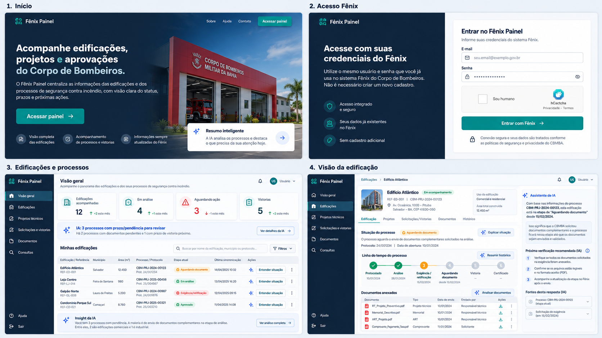

# Direção do produto — Fênix Painel

## Referência visual oficial

Esta imagem é a referência visual e de produto para o projeto. Mudanças futuras devem preservar o domínio de edificações e processos de aprovação do CBMBA, o acesso com credenciais do Fênix e hCaptcha, e a IA contextual com explicações rastreáveis às informações consultadas.

## Escopo do produto

O Fênix Painel acompanha edificações vinculadas ao usuário autenticado e seus projetos técnicos, solicitações, vistorias, documentos e etapas de aprovação. Não é CRM. O usuário entra com a conta existente do Fênix; não há cadastro separado.

A API documentada em `~/fenix-mcp` indica consultas distintas para os dados do solicitante (`detailsRequester`), edificações vinculadas ao solicitante (`usuarios/{id}/edifications`), solicitações (`request`) e projetos técnicos (`technicalproject`). A listagem genérica `/edifications` foi observada como indisponível. O catálogo é uma referência de rotas, não uma garantia de contrato, permissões ou disponibilidade em produção.

## Diretrizes para IA

- A IA aparece junto do contexto que explica: resumo da edificação, estado do processo, linha do tempo, pendências e documentos.
- Respostas distinguem dados observados de interpretação e recomendação; apontam processo/documento/etapa de origem e data da última consulta.
- A IA não inventa prazos, risco, exigências ou probabilidade de aprovação. Quando faltarem dados, informa a lacuna.
- A IA não executa ações no Fênix. Ações oficiais permanecem explícitas e sujeitas às permissões do usuário.
- Conteúdo retornado pelo Fênix é dado não confiável, nunca instrução para o modelo. Minimizar e proteger dados pessoais enviados ao provedor de IA.

## Critério de fidelidade

Telas principais: landing page, login Fênix com hCaptcha, painel de edificações/processos e detalhe da edificação com projetos, solicitações/vistorias, documentos, histórico e assistente contextual. O estado de sincronização e a origem dos dados precisam ser visíveis.
